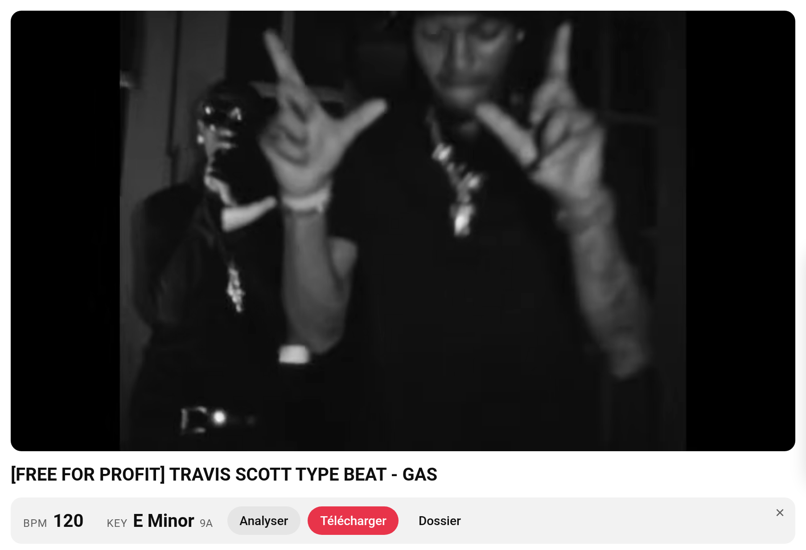
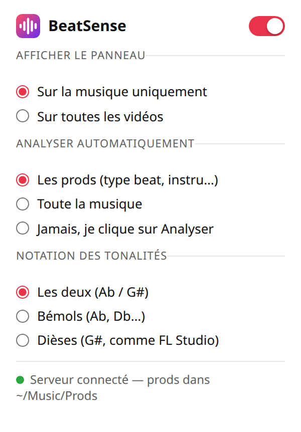

# BeatSense

**BPM & key finder for YouTube beats, with one-click MP3 download.** A free, open-source Firefox and Chrome extension for beatmakers and producers: on any YouTube type beat or instrumental, BeatSense shows the tempo (BPM), the musical key (with Camelot notation) and downloads the beat as an MP3 straight into your prods folder, with BPM and key in the file name.

  
  &nbsp;
  

## Features

- **BPM detection**: tempo shown right under the video title, with half / double time alternatives.
- **Key detection**: musical key in standard notation (flats, sharps or both) and Camelot wheel notation for harmonic mixing.
- **MP3 download**: saves the instrumental to `Music/Prods` as `Title [140 BPM A minor].mp3`, so BPM and key show up right in your DAW's file browser (FL Studio, Ableton…).
- **Automatic**: analysis runs by itself on music videos (YouTube Music category, or titles like *type beat*, *instrumental*, *prod.*…). The toolbar button lets you turn it off, show the panel on every video, or tune auto-analysis.
- **Runs locally**: audio analysis happens in your browser with [essentia.js](https://github.com/MTG/essentia.js). No account, no tracking, no cloud.

## Installation

BeatSense is not on the extension stores: it installs from this repository's releases (signed by Mozilla for Firefox, loaded "unpacked" in Chrome).

**Windows**, in PowerShell:

    irm https://raw.githubusercontent.com/hugomyb/beatsense/main/install.ps1 | iex

**Linux**, requires ffmpeg and [uv](https://docs.astral.sh/uv/):

    git clone https://github.com/hugomyb/beatsense && cd beatsense && ./install.sh

Both scripts start the local server at login, then:

- **Firefox**: click "Add".
- **Chrome**: on the extensions page that opens, enable "Developer mode", click "Load unpacked" and pick the folder printed by the script (`%LOCALAPPDATA%\BeatSense\chrome-extension` on Windows, `~/.local/share/beatsense/chrome-extension` on Linux).

Beats are saved to `Music/Prods` (set the `BEATSENSE_DIR` environment variable to change it).

## How it works

- `extension/`: the panel under music video titles, and the essentia.js analysis.
- `extension/chrome/`: Chrome specifics (Manifest V3): essentia.js runs in a sandboxed page through an offscreen document. `./build.sh` builds `build/firefox` and `build/chrome`.
- `server/`: a tiny local server (127.0.0.1:7843) that fetches the audio with yt-dlp, which a browser extension can't do on its own.

## Updates

Everything updates automatically:

- Firefox extension: Firefox checks `updates.json` every 24 h (or `about:addons` > "Check for Updates").
- Chrome extension: the server replaces the folder's files with the latest release and the extension reloads itself (checked hourly).
- Server: updates yt-dlp daily (YouTube breaks it regularly) and, on Windows, replaces itself with the latest `server/beatsense.py`.

Publishing a new version: `./release.sh 1.4.0` (builds both versions, Mozilla signing, GitHub release and `updates.json`).

## Accuracy

Tuned on 58 type beats whose descriptions state BPM and key: exact key in 76% of cases (`edmm` profile on the whole track), tempo within ±1 BPM in 84% of cases, and 97% counting half / double time (shown in small next to the main value).

## Troubleshooting

- "BeatSense server unreachable": restart your computer, or re-run the install command.
- Logs on Linux: `journalctl --user -u beatsense -f`

## License

AGPL-3.0, like [essentia.js](https://github.com/MTG/essentia.js), which is bundled in the extension.
